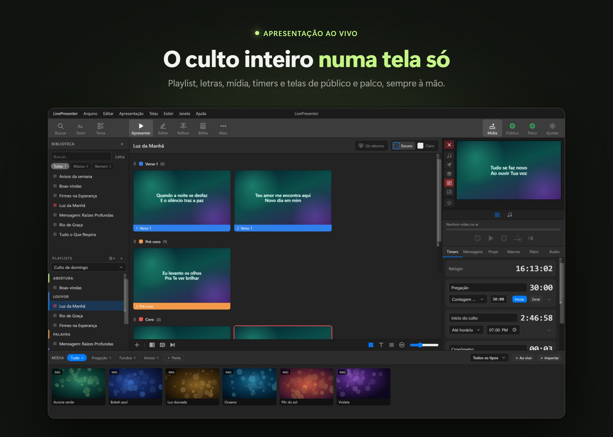
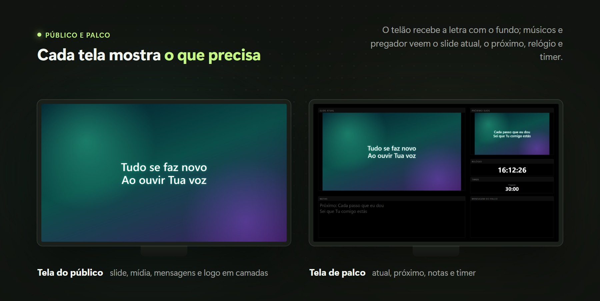
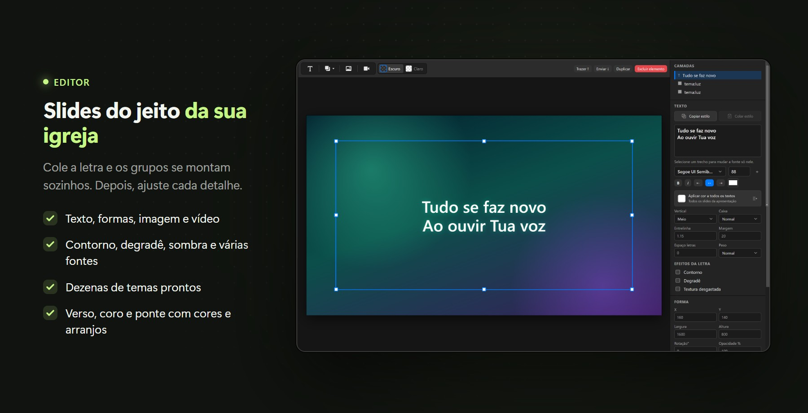

<picture>
  <source media="(prefers-color-scheme: dark)" srcset="assets/logo-dark.png">
  
</picture>

  

**Apresentação ao vivo para igrejas e eventos: letras, Bíblia, vídeos e telas de público e palco.**

### [⬇ Baixar o instalador para Windows](https://github.com/Rezend3v/presenter-releases/releases/latest)

Ou veja todas as versões na página de <a href="https://github.com/Rezend3v/presenter-releases/releases">releases</a>.

 

---

## ✨ O que ele faz

| | |
|---|---|
| 🎵 **Letras e músicas** | Cole a letra com `[Verso 1]`, `Coro:`… e os grupos são montados sozinhos. Busque letras pelo nome da música, com detecção automática de verso, coro e ponte. Arranjos, temas e cores por grupo. |
| 📖 **Bíblia** | Importe traduções (Zefania, OSIS ou JSON) e busque por referência — `João 3:16-18`, `Sl 23`, `Rm 8.28`. |
| 🖥️ **Público e palco** | Tela do público em tela cheia, com mídia, slide, props, mensagens e logo em camadas. Tela de palco com slide atual e próximo, notas, relógio e timer. |
| 🎬 **Mídia e transições** | Imagens, vídeos e áudio de fundo, troca sem quadro preto e 29 transições — de dissolver a efeitos 3D e VFX. |
| 📷 **OBS e câmeras** | Use a câmera virtual do OBS, webcams ou placas de captura como fundo, com a letra por cima. |
| 📱 **Controle pelo celular** | Aponte a câmera para o QR code e controle slides, playlist, mensagens e macros pelo navegador, na rede local. |
| ⏱️ **Timers e mensagens** | Contagem regressiva, até horário e cronômetro; mensagens com campos e macros que combinam ações. |
| ☁️ **Google Drive** | Sincronize biblioteca, temas e fontes entre os computadores da equipe. |
| 🔁 **Importação** | Traga apresentações do ProPresenter 7 (`.pro`) e arquivos locais do Presenter by WorshipTools. |
| ✍️ **Editor completo** | Texto, formas, imagem e vídeo, várias fontes no mesmo bloco, contorno, degradê, sombra e dezenas de temas prontos. |

  

  

## 💾 Instalar

1. Baixe o **[LivePresenter-Setup](https://github.com/Rezend3v/presenter-releases/releases/latest)** da versão mais recente.
2. Abra o arquivo. Se o Windows mostrar **"O Windows protegeu o computador"**, clique em **Mais informações** → **Executar assim mesmo**.
   O aviso aparece porque o instalador ainda não tem assinatura digital; não é um problema com o arquivo.
3. Escolha a pasta de instalação e pronto — o atalho fica na área de trabalho.

> **Versão portátil:** o `LivePresenter-Portable` roda sem instalar (por exemplo, de um pendrive), mas **não recebe atualizações automáticas**. Para o dia a dia, prefira o instalador.

## 🔄 Atualizações automáticas

A versão instalada se atualiza sozinha — não é preciso baixar de novo.

- O LivePresenter procura versões novas ao abrir e a cada 4 horas, e baixa em segundo plano.
- **Durante o culto nada acontece:** com a tela de público ou de palco no ar, ele não baixa nem mostra avisos, para não disputar a internet da transmissão.
- Quando a atualização fica pronta, aparece um cartão discreto no canto: **Reiniciar e atualizar**, ou ela é instalada quando você fechar o programa.
- Para verificar na hora: **Ajuda → Procurar atualizações…**

## ⌨️ Atalhos

| Tecla | Ação |
|---|---|
| `→` `↓` `Espaço` `PgDn` | Próximo slide (continua no próximo item da playlist) |
| `←` `↑` `PgUp` | Slide anterior |
| `F1` … `F6` | Limpar tudo / slide / mídia / áudio / props / mensagens |
| `F7` | Logo |
| `Ctrl+E` | Modo Editar |
| `Ctrl+Z` / `Ctrl+Y` | Desfazer / refazer |
| `Ctrl+T` | Temas |

## 🖥️ Requisitos

- Windows 10 ou 11, 64 bits
- Uma segunda tela ou projetor para o público (opcional para testar)
- Internet só para atualizações, busca de letras e sincronização — o programa funciona offline

## ❓ Perguntas frequentes

<b>Onde ficam minhas apresentações e mídias?</b>

Em `%APPDATA%\LivePresenter`. Atualizar ou reinstalar o programa não apaga a biblioteca.

<b>Posso usar em mais de um computador?</b>

Sim. Instale em cada um e, se quiser manter tudo igual, ligue a sincronização com o Google Drive em **Configurações**.

<b>A atualização vai interromper o culto?</b>

Não. Com público ou palco abertos, o LivePresenter não baixa nem pede para reiniciar. Nada é instalado sem você clicar em **Reiniciar e atualizar** ou fechar o programa.

<b>O antivírus ou o SmartScreen bloqueou o instalador. E agora?</b>

Baixe sempre por esta página. No SmartScreen, clique em **Mais informações → Executar assim mesmo**. Se o antivírus reclamar, adicione uma exceção para o arquivo baixado daqui.

---

Este repositório contém apenas os instaladores do LivePresenter · <a href="https://rezend3v.github.io/presenter-app/privacy.html">Política de privacidade</a>

